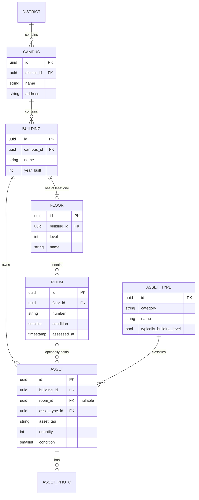

# Campus Walk

This is Web app that is intended for walking a school campus and record what is in every room. This is a fullstack app.

What to build:

- In the field: a way for the a user in the field to browse a Campus and to see it's buildings, floors, rooms and other items contained within. The primary ability to create assets and to move them, update them, and remove them and to attach other important data to them such as photos and notes. 

- In the Office: a way for an office user to see a summary of the above per campus with other useful summary metrics such as asset counts, items by condition level, and unassessed rooms. 

The data model is heirarchical Campus → Building → Floor → Room → Asset. 

Setting up for the first time? Skip to [Getting started](#getting-started).

# Data Model

District → Campus → Building → Floor → Room → Asset, plus an `asset_type` catalog. An asset always belongs to a building and optionally to a room (a null room is a building-level system or unplaced equipment). Assessment (`condition`, `notes`, `assessed_at`) is current state stored on `room` and `asset`. The rules that matter when writing queries are in `CLAUDE.md` → Data model; the source of truth is `apps/api/src/db/schema.ts`.




## Data Persistence 

For our Database, I'd like to use NeonDB. Honestly the Dev Experience is pretty awesome because it allows to "branch" off of a parent DB instance and this is pretty nice feature when you use worktrees for every feature you implement. And having a service manage your Postgres for you is just nice, no managing Postgres version updates, data protection and backup guarantees, and just general always available service. The less things to maintain and keep track of the better. Tradeoff is that our data is locked into Neon and data is very sticky and can be expensive to migrate off in-volume.

## User Roles

  field

  admin

### Permissions System

an ABAC (Attribute Based Access Control) permissions system is more powerful than normal RBAC (Role Based Access Control). RBAC only defines what actions are allowed for what roles. ABAC allows more granualar, contextual control over access which is powerful. I've used a hybrid model in the past which combines the ease of adminitration of RBAC with the fine-grain control of ABAC. 

 Enterpise level permissions abstraction can be used to control access, and thus what is usable and 'visible' to users on the front end. This abstraction will hide elements in the UI from user's who don't have access and simultaneously 

 I am going to be using BetterAuth for this project, I've rolled my own auth code in past and I've read that BetterAuth just offers alot of feature out of the box that are very helpful that you don't have to manage yourself. Just general user management with builtin authentication options and session management out of the box. 


## Tech Stack

TypeScript
Vite + Fastify Server
relational DB, for this app Postgres (NEON DB)
tRPC
BetterAuth


## Interesting Design/App questions

- what if a user takes a picture of every room and the app tells you if you forgot to notate something in that room?

- Maybe show the route the field user took through the campus/building

- transactional history, who touched what and when?


## Getting started

Monorepo managed with pnpm. `apps/api` is a Fastify server exposing a tRPC router backed by Drizzle and Neon Postgres. `apps/web` is a Vite + React SPA that calls the router through TanStack Query with end-to-end types.

Prerequisites:

- Node.js 20 or newer
- pnpm 10 (`corepack enable` picks up the version pinned in `package.json`)
- A free [Neon](https://neon.tech) account (`pnpm db:setup` signs you in through the browser)
- `jq`, only for the test database setup (`pnpm db:setup:test`) and the worktree scripts

First run, from the repo root:

```bash
pnpm install                          # install both apps
pnpm db:setup                         # sign in to Neon, create the "campus-walk" project, write apps/api/.env
                                      #   (DATABASE_URL, PORT, and a generated BETTER_AUTH_SECRET)
pnpm --filter api db:migrate          # create the tables
pnpm --filter api db:seed:permissions # roles, permission catalog, and default grants (safe to re-run)
pnpm db:seed                          # load the sample district (truncates the campus data first)
pnpm --filter api auth:create-admin -- --email you@example.com --name "Your Name" --password 'choose-one'
pnpm dev                              # API on http://localhost:3001, web on http://localhost:5173
```

Then open http://localhost:5173 and sign in with the admin account you just created. There is no public sign-up: other users join through invites sent by an admin from the app.

`apps/api/.env.example` lists every variable the API reads. `pnpm db:setup` fills in the required ones; the defaults for the rest (`APP_URL`, `API_URL`) match the ports above. If you already had an `apps/api/.env` without `BETTER_AUTH_SECRET`, re-running `pnpm db:setup` adds one without touching anything else.

Other commands:

```bash
pnpm typecheck                    # tsc for both apps
pnpm build                        # production build of both apps
pnpm --filter api db:generate     # drizzle-kit: generate a migration from src/db/schema.ts
pnpm --filter api db:migrate      # drizzle-kit: apply migrations
```

## Testing

```bash
pnpm db:setup:test                      # one-time: Neon branch "test" → apps/api/.env.test, migrate, seed
pnpm exec playwright install chromium   # one-time
pnpm test                               # Vitest: API router tests on the test branch + web unit tests
pnpm test:e2e                           # Playwright: real API (3101) + web (5174) on the test branch
```

Vitest tests sit next to the code (`*.test.ts`); Playwright specs are one file per feature in `e2e/`. Both use the Neon `test` branch from `apps/api/.env.test` and never the dev database. Conventions and details: `CLAUDE.md` → Testing.

`pnpm db:setup` is idempotent: it skips Neon if `apps/api/.env` already has `DATABASE_URL`, and only generates `BETTER_AUTH_SECRET` when it is missing. Set `NEON_PROJECT_NAME` or `NEON_REGION` to override the defaults, `NEON_ORG_ID` if your account belongs to more than one Neon organization, or `NEON_API_KEY` to skip the browser login (CI).

Layout:

```
apps/api/src/router.ts    tRPC procedures; exports AppRouter type consumed by the web app
apps/api/src/db/schema.ts Drizzle schema: district → campus → building → floor → room → asset, + asset_type
apps/api/src/db/seed.ts   loads sample_data/campus_walk_sample_data (see CLAUDE.md "Data model" for the rules)
apps/web/src/trpc.ts      typed tRPC client + React hooks
apps/api/src/auth/        Better Auth setup, roles, permission catalog, create-admin script
apps/web/src/walk/        field walk screen (campus → building → floor → room → asset)
apps/web/src/office/      office summary screen
scripts/setup-neon.mjs    Neon provisioning
```


